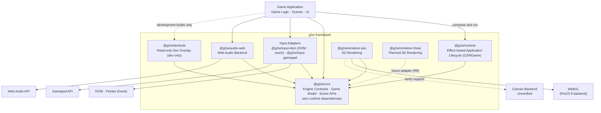
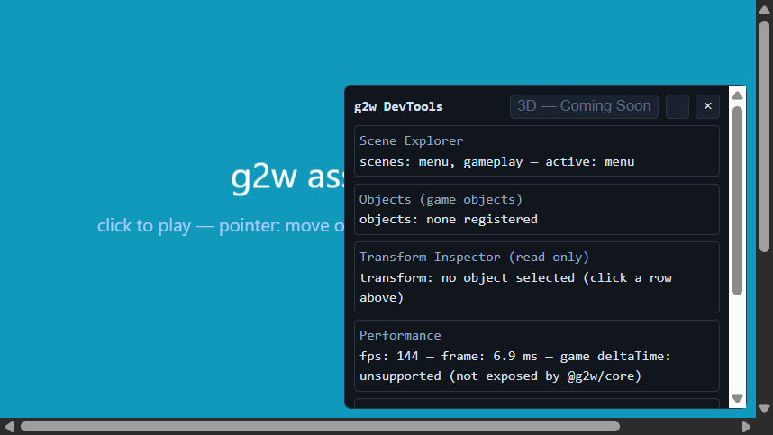
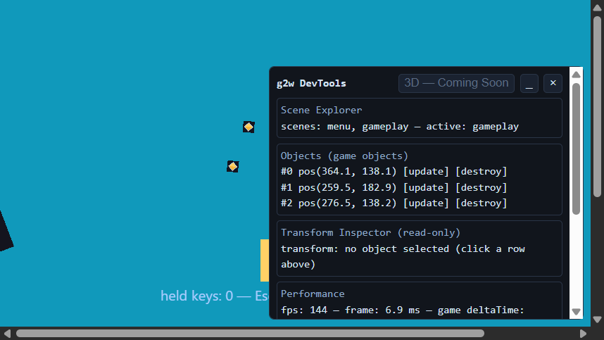
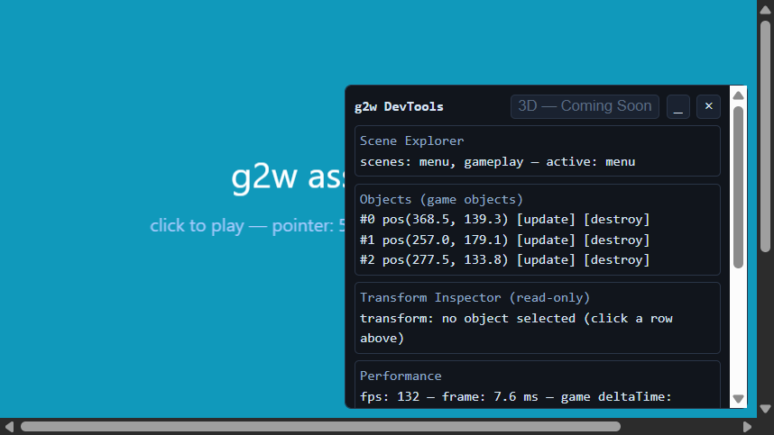
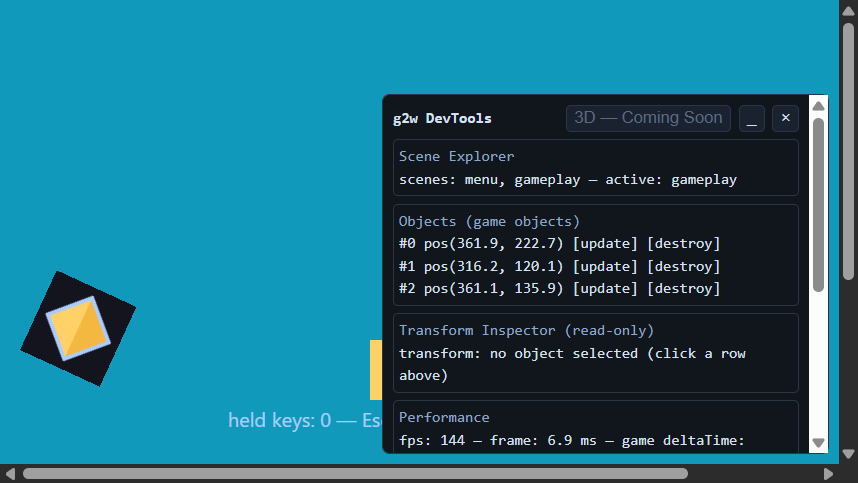

# g2w - Game To Website

**g2w — Game to Website** is a TypeScript-first, AI-agent-ready framework for building and shipping web games: HTML5 games, 2D first with 3D planned, for desktop and mobile web browsers.

> **Status: MVP R5 + E3 (Effect runtime and adapter lifecycle hardening) — gamepad & touch input.** The repository provides a `Game` runtime (lifecycle + frame loop), a renderer-agnostic `SceneManager`, a DOM-free `InputState` with a browser adapter plus a DOM-free `GamepadState` with a Gamepad API adapter (`@g2w/input-gamepad`), a minimal asset system (`AssetManager` in core plus a PixiJS texture loader in the renderer adapter), a renderer-agnostic 2D sprite model (`Transform2D`/`Sprite2D` in core with normalized anchors and z-order, projected onto PixiJS by the adapter), a minimal game-object layer (`GameObject`/`GameObjectCollection` in core), and a small ownership-explicit audio system (`AudioManager` in core plus a Web Audio backend in `@g2w/audio-web`) on top of the MVP 0 foundation: monorepo, renderer contract, PixiJS adapter, a working browser demo, and the Effect-based `@g2w/runtime` foundation (E1 bootstrap plus the E2 Effect-native game lifecycle in `@g2w/runtime`; core `Game` is unchanged). See [What is implemented](#what-is-implemented) below.

## Architecture

g2w is a pnpm monorepo of small packages with one strict rule: **`@g2w/core` never depends on a rendering technology.** Renderers implement the core contract and depend on core, never the other way around.

```text
packages/core/src/index.ts        Renderer contract + RendererError + Game runtime + SceneManager + InputState + GamepadState + AssetManager
packages/input-dom/src/           DOM (browser) adapter feeding InputState from real events (keyboard, pointer, touch)
packages/input-gamepad/src/       Gamepad API (browser) adapter sampling controllers into GamepadState
packages/audio-web/src/           Web Audio (browser) backend: decodes sound files, owns the AudioContext
packages/renderer-pixi/src/       PixiJS implementation of the renderer contract + texture asset loader
packages/devtools/src/            Read-only dev overlay: scenes, objects, transforms, FPS, input, logs
packages/runtime/src/             Effect-based runtime/bootstrap foundation (managed runtime, explicit shutdown) + Effect-native game lifecycle (G2WGame)
examples/hello-world/             Vite browser demo: Game + SceneManager + input + PixiRenderer
docs/architecture.md              Architecture decisions and direction
```

For the full picture, read [docs/architecture.md](docs/architecture.md).

## Target Architecture

The diagram below shows the **intended target architecture** — where g2w is going, not a claim that every planned capability exists. Solid edges and current package names reflect what is implemented and tested today; dashed edges mark planned or unverified capabilities. See [ROADMAP.md](ROADMAP.md) for statuses and [docs/architecture.md](docs/architecture.md) for the implemented design.



### Layer responsibilities

| Layer / package          | Responsibility                                                                                                                                                                                       | Current status                                                                                                |
| ------------------------ | ---------------------------------------------------------------------------------------------------------------------------------------------------------------------------------------------------- | ------------------------------------------------------------------------------------------------------------- |
| `@g2w/core`              | Renderer-agnostic engine foundation: renderer contract, `Game` runtime, `SceneManager`, DOM-free `InputState`/`GamepadState`, `AssetManager`, `Transform2D`/`Sprite2D`, game objects, `AudioManager` | Done — zero runtime dependencies, enforced by architecture tests                                              |
| `@g2w/runtime`           | Effect-based application orchestration: one managed Effect runtime, `G2WGame` lifecycle with LIFO finalizers, idempotent shutdown with observable cleanup failures                                   | Done (E1 + E2) — Effect only here, never in core or adapters                                                  |
| `@g2w/renderer-pixi`     | Implements the renderer contract on PixiJS 8: async `Application` lifecycle, logical sizing, sprite views, texture loading                                                                           | Done — 2D rendering through WebGL                                                                             |
| `@g2w/input-dom`         | Adapts DOM keyboard, pointer, and touch (Pointer Events) onto `InputState`                                                                                                                           | Done                                                                                                          |
| `@g2w/input-gamepad`     | Samples the Gamepad API into `GamepadState` through caller-driven `poll()`                                                                                                                           | Done                                                                                                          |
| `@g2w/audio-web`         | Web Audio backend for the core `AudioManager`: decode, playback, `AudioContext` ownership, autoplay `resume()`                                                                                       | Done                                                                                                          |
| `@g2w/devtools`          | Read-only development overlay observing core state through immutable snapshots                                                                                                                       | Done — opt-in, dev-only, absent from production builds                                                        |
| Asset management         | Generic `AssetManager` in core; non-destructive PixiJS texture loader in the renderer adapter                                                                                                        | Done                                                                                                          |
| `@g2w/renderer-three`    | 3D rendering adapter proving the renderer contract generalizes                                                                                                                                       | Exploratory ([ROADMAP.md](ROADMAP.md) R8) — no package exists yet                                             |
| Canvas rendering backend | 2D rendering without WebGL                                                                                                                                                                           | Unverified — PixiJS 8 dropped its canvas renderer; documented here as a direction to verify, not a capability |

### Architecture principles

- **Dependency direction.** Everything above the core depends on `@g2w/core`; core depends on nothing at runtime. Applications compose the packages directly — the Effect runtime orchestrates the lifecycle, but adapters are plain imperative packages a host wires up and registers for cleanup.
- **Renderer independence.** Game code targets the renderer contract in core, never PixiJS. A future Three.js adapter would provide 3D the same way, without Three.js reaching the core.
- **Effect ownership.** Effect is the application-runtime technology, confined to `@g2w/runtime`: it owns lifecycle, resource acquisition/release, initialization failure, and shutdown. No Effect execution or fiber per frame — the frame loop stays synchronous on one injected scheduler, with no runtime, effect, or promise allocated per frame.
- **Adapter boundaries.** Browser APIs (DOM events, Pointer Events, Gamepad API, Web Audio) live only in adapter packages; core stays DOM-free and renderer-free, keeping the engine portable and independently testable.
- **Explicit ownership.** Every resource (display objects, listeners, contexts, playbacks) has a documented owner and a safe disposal path; shared resources like textures are never destroyed by framework disposal.

### Current vs. planned capabilities

| Capability                                | Status                                                                                                      |
| ----------------------------------------- | ----------------------------------------------------------------------------------------------------------- |
| Effect as the primary application runtime | Done for the game lifecycle (`G2WGame`); core `Game` still ships alongside it and the demo uses core `Game` |
| 2D rendering                              | Done — PixiJS 8 over WebGL                                                                                  |
| Canvas (non-WebGL) rendering              | Unverified target                                                                                           |
| 3D rendering                              | Exploratory — Three.js adapter (R8)                                                                         |
| Touch input                               | Done — multi-touch through the Pointer Events stream                                                        |
| Desktop and mobile web browsers           | Target platform; verified today on desktop browsers via the demo's smoke runs                               |

## Prerequisites

- Node.js 22 or newer
- pnpm 12 (activated automatically via `packageManager`, e.g. through Corepack)

## Getting started

```sh
pnpm install
```

## Development commands

| Command               | What it does                                            |
| --------------------- | ------------------------------------------------------- |
| `pnpm dev`            | Run the hello-world browser demo with Vite              |
| `pnpm build`          | Type-check and build all packages to `dist/`            |
| `pnpm build:example`  | Build the hello-world demo bundle (production build)    |
| `pnpm typecheck`      | Type-check all sources, tests, and examples (no output) |
| `pnpm check`          | Format and lint check with Biome                        |
| `pnpm format`         | Auto-format sources with Biome                          |
| `pnpm test`           | Run all tests with Vitest                               |
| `pnpm verify:exports` | Verify built packages load through their entry points   |

## What is implemented

- **Monorepo foundation** — pnpm workspaces, strict TypeScript (`tsconfig.base.json`), Biome formatting and linting, Vitest tests, GitHub Actions CI (`.github/workflows/ci.yml`).
- **Renderer contract** — `@g2w/core` defines `Renderer` (with an optional `render()` hook), `RendererCapabilities`, `RendererInitOptions`, and `RendererError`. Core has zero runtime dependencies and no PixiJS dependency; tests enforce this boundary.
- **Game runtime** — `Game` owns a renderer and a `requestAnimationFrame` frame loop with explicit lifecycle states (`new` → `initializing` → `initialized` → `running` ⇄ `stopped` → `disposed`), a seconds-based `deltaTime` update callback, and deterministic handling of concurrent init, stop-during-init, and disposal races. See [docs/architecture.md](docs/architecture.md) for the state model.
- **Scene system** — `SceneManager` owns a fixed set of named, reusable `Scene` objects: `init` runs once per instance, `enter`/`exit` pair on every activation, and only the active scene is updated. Transitions exit the previous scene before entering the next one, are immediate outside scene hooks, and deferred when requested from inside one — the most recent request always wins. Disposal is terminal, best-effort, and releases every initialized scene. See [docs/architecture.md](docs/architecture.md) for the full lifecycle and transition semantics.
- **PixiJS adapter** — `@g2w/renderer-pixi` implements the contract with PixiJS 8's async `Application` lifecycle and renders on demand (`render()`, `stage` access). It is a minimal adapter, not a complete renderer yet.
- **Browser demo** — `examples/hello-world` is a real Vite app: the `Game` loop updates the active scene, two scenes (menu and gameplay) demonstrate real transitions, and the gameplay square is moved with WASD/arrow keys, a gamepad (left stick or d-pad), or touch drag through the input API. Run it with `pnpm dev`.
- **Input system** — `@g2w/core` provides the DOM-free `InputState` (keyboard held/pressed/released, pointer position, button state, multi-touch contacts, focus-loss and pointer-leave policies) and the DOM-free `GamepadState` (per-controller buttons with per-frame edges, raw analog axes, explicit connect/disconnect policy). `@g2w/input-dom` adapts real browser events onto `InputState` — touch contacts ride the same Pointer Events stream, and `pointercancel` releases stuck state — while `@g2w/input-gamepad` samples controllers through an injectable polling source driven by the host each frame. Edge states reset at one explicit boundary (`endFrame()`) per game frame. See [docs/architecture.md](docs/architecture.md) for the frame semantics.
- **Asset system** — `@g2w/core` provides a generic, dependency-free `AssetManager`: asynchronous loading through a caller-supplied loader, caching, deduplication of concurrent requests, retryable failures, and explicit resource ownership (a supplied `disposeAsset` makes the manager own its values; without one, values stay caller-owned). `@g2w/renderer-pixi` adds `createTextureAssetManager()`, which loads PixiJS textures by URL and is deliberately non-destructive: textures from PixiJS's shared `Assets` cache are never destroyed by manager disposal, because PixiJS offers no way to prove no other code still uses them. See [docs/architecture.md](docs/architecture.md) for the ownership rules and the memory trade-off.
- **2D sprite model** — `@g2w/core` provides `Transform2D` (mutable `x`/`y`, `rotation` in radians, `scaleX`/`scaleY`; defaults `0, 0, 0, 1, 1`) and `Sprite2D<TTexture>` (typed texture handle, transform, `visible`, `alpha`) — plain mutable data with no renderer coupling. `@g2w/renderer-pixi` adds `createSpriteView({ sprite, renderer })`, which attaches a PixiJS sprite to the stage; game code mutates the model and calls `view.sync()` once per frame (the existing game loop is the only driver), and `view.dispose()` removes and destroys the display object without ever destroying the shared texture. See [docs/architecture.md](docs/architecture.md) for the ownership rules.
- **Sprite anchors and z-order (R11)** — `Sprite2D` gains a normalized `anchor` (`Anchor2D`: `0` left/top edge, `0.5` center, `1` right/bottom edge; default `(0, 0)` preserves the original top-left placement) and a `zIndex` (default `0`). The anchor decides where the position lands and what rotation and scale revolve around — a center anchor `(0.5, 0.5)` spins a sprite around its middle, a feet anchor `(0.5, 1)` puts the position at its bottom-center. `anchor.set(x, y)` is the only mutation path and rejects non-finite or out-of-range values with `SpriteError` instead of clamping. `zIndex` layers sprites deterministically: higher values render in front, and equal values keep their current order. Both are applied by the same `view.sync()` call. See [docs/architecture.md](docs/architecture.md).
- **Scene ownership hardening** — a scene instance belongs to exactly one `SceneManager` for its lifetime: registering the same instance in another manager (or twice in one record) throws `SceneError`, and the claim survives the owning manager's disposal. `exit` deactivates a scene; disposal is what is permanent. See [docs/architecture.md](docs/architecture.md).
- **Game objects** — `@g2w/core` provides `GameObject` (a `Transform2D` plus optional `update(deltaTime)` and `destroy()` hooks) and `GameObjectCollection`, a minimal registry that updates registered objects through the existing game loop — no second loop, no ECS, no scene graph. A collection claims each object (one collection at a time; re-registrable after removal), duplicate or cross-collection registration throws `SceneError`, updates iterate a snapshot (adding during `update` takes effect next frame, removing during `update` — including an object removing itself — takes effect immediately), and `destroy()` runs each still-registered object's `destroy` hook exactly once, never touching shared textures or other externally owned resources. See [docs/architecture.md](docs/architecture.md) for the full contract.
- **Audio (R4)** — `@g2w/core` provides a small, ownership-explicit `AudioManager` following the asset-manager pattern: an injected browser-free `AudioBackend` loads sounds (cached, deduplicated, retryable failures), `play(key, options?)` starts a tracked playback with `volume`/`loop` and returns an idempotent `SoundPlayback` handle, `stopAll()` and terminal `dispose()` stop everything, and the manager **never destroys sounds** — decoded audio stays caller/backend-owned so it can be shared freely. `@g2w/audio-web` implements the backend on the Web Audio API: injectable `AudioContext`/`fetch`, `resume()` for the browser autoplay policy (`play()` on a suspended context throws instead of starting silently inaudible playback), and `dispose()` that closes the context. No second loop, no hidden timers. See [docs/architecture.md](docs/architecture.md).
- **DevTools (read-only overlay)** — `@g2w/devtools` provides an opt-in, dev-only DOM overlay that observes a running game without touching it: the scene list (via `SceneManager.keys`), registered game objects and their transforms (via `GameObjectCollection.objects()`), explicitly watched input keys/buttons, FPS/frame time, and a bounded runtime log buffer. It polls immutable snapshots at a fixed refresh rate — it never mutates the runtime, never disposes it, and is excluded from production builds (the demo loads it only behind `import.meta.env.DEV`). A disabled "3D — Coming Soon" placeholder marks the planned 3D inspector. See [docs/architecture.md](docs/architecture.md).
- **Effect runtime foundation (E1)** — `@g2w/runtime` bootstraps one managed Effect runtime from an optional application layer: eager layer build (bootstrap failures report as `RuntimeBootstrapError` with the original cause, after partial-build resources are released), a small facade (`run`, `addFinalizer`, `shutdown`), explicit idempotent shutdown, and best-effort cleanup that attempts every finalizer and keeps each failure observable (`RuntimeShutdownError.failures`). See [docs/architecture.md](docs/architecture.md).
- **Effect-native game lifecycle (E2)** — `@g2w/runtime` also exports `G2WGame`, the same state machine, frame-loop semantics, and race behavior as core `Game`, orchestrated through the managed Effect runtime: renderer initialization runs as a single lifecycle effect (original error causes preserved; a failed init returns to `"new"` and is retryable), resource ownership is expressed as runtime finalizers (LIFO release: caller finalizers, then owned scenes, then the renderer), and disposal is idempotent with every cleanup failure observable. The frame loop stays synchronous on exactly one injected scheduler — no Effect runtime, effect, or promise is allocated per frame. Core `Game` is unchanged; the demo still uses it, so the browser bundle is unaffected. See [docs/architecture.md](docs/architecture.md).
- **Renderer sizing (R3)** — logical resolution is part of the renderer contract: `width`/`height` on `Game`/`RendererInitOptions` set the stage coordinate space game code uses (both or neither, validated), the drawing buffer is `logical × resolution`, and display size stays application-owned CSS. `Renderer.resize(width, height)` changes the logical space at runtime without ever touching textures. `@g2w/input-dom`'s `logicalSize` option maps pointer coordinates into the game's logical space, so input stays correct under CSS display scaling. The default policy — fixed logical resolution with proportional display scaling — is documented in [docs/architecture.md](docs/architecture.md).

For implementation details, read [ARCHITECTURE.md](ARCHITECTURE.md); for current priorities and planned work, read [ROADMAP.md](ROADMAP.md).

## Hello-world demo

The browser demo demonstrates the full stack — scenes, input, assets, sprites, and game objects — in a menu → gameplay → menu flow:









From top to bottom: the menu scene on startup ("texture cache: hit" proves the repeated asset request reused the cached texture); the gameplay scene with a spark `GameObjectCollection` orbiting through the existing game loop, the yellow square moved by WASD/arrows, and the logo sprite driven by the core sprite model; the return to menu after pressing Esc; and gameplay re-entry, where sparks keep their state and no duplicate display objects are created.

In development (`pnpm dev`) the demo also opens the `@g2w/devtools` overlay (scene explorer, object list, transform inspector, FPS, watched input, runtime log); it is loaded dynamically behind `import.meta.env.DEV` and absent from production builds.

Note on the screenshots: they were captured from a real headed-Chrome session via the DevTools protocol and show the fully rendered page, including the WebGL game canvas (menu blue background, gameplay square, sparks, and page hints) alongside the DevTools overlay. Capturing this canvas headlessly is not possible — a canvas created without `preserveDrawingBuffer` reads back black through protocol screenshots — which is why the captures were taken from a headed, on-screen session; this is a capture-tooling limitation, not a rendering defect (an in-page `drawImage` readback of the live canvas returns real frame content).

## Current limitations

- **No ECS or scene-graph object model** — `GameObject`/`GameObjectCollection` is a minimal update/destroy registry with transform sharing; there are no components, hierarchies, parent/child transforms, or query systems.
- **No physics, collision, camera, or tilemap system.**
- **No dedicated animation framework** — animation is done by mutating models in `update(deltaTime)` (the demo does this for rotation/scale); there are no tweening, keyframe, or skeletal systems.
- **No key/button remapping, action mapping, or rebinding** — gamepad and touch deliver raw button/axis/position state; remapping and high-level action systems are future roadmap items.
- **No 3D adapter** — the Three.js adapter is exploratory ([ROADMAP.md](ROADMAP.md) R8).
- **Texture lifetime is non-destructive** — neither the asset manager nor the renderer ever destroys textures from PixiJS's shared cache; they live until page unload unless the application unloads them explicitly (the resolved R1 decision, documented in [ARCHITECTURE.md](ARCHITECTURE.md) and [ROADMAP.md](ROADMAP.md)).
- **DevTools is read-only and dev-only** — the overlay observes snapshots only (scenes, registered objects, explicitly watched keys/buttons, FPS, bounded log); it cannot mutate the runtime, does not see unwatched input, labels objects positionally (`#N`, not stable IDs), and is not included in production bundles.

## Minimal usage

```ts
import {
  AssetManager,
  Game,
  type GameObject,
  GameObjectCollection,
  InputState,
  SceneManager,
  type Scene,
  Sprite2D,
  Transform2D,
} from "@g2w/core";
import { DomInput } from "@g2w/input-dom";
import { createSpriteView, createTextureAssetManager, PixiRenderer } from "@g2w/renderer-pixi";

const renderer = new PixiRenderer();
const input = new InputState();
const domInput = new DomInput(input, {
  canvas: document.querySelector("canvas")!,
  // Pointer positions arrive in the game's logical space.
  logicalSize: { width: 640, height: 360 },
});
const assets = createTextureAssetManager();
const texture = await assets.load("assets/logo.png");

// A renderer-agnostic sprite: game code mutates this model only.
const logo = new Sprite2D({ texture, transform: new Transform2D({ x: 16, y: 32 }) });
const logoView = createSpriteView({ sprite: logo, renderer });

const menu: Scene = {
  enter() {
    /* show menu */
  },
  update() {
    if (input.wasButtonPressed(0)) scenes.goTo("gameplay");
  },
  exit() {
    /* hide menu */
  },
};
const gameplay: Scene = {
  update(deltaTime) {
    if (input.isKeyDown("KeyD")) x += 120 * deltaTime;
    logo.transform.rotation += deltaTime * 1.5; // radians per second
    logoView.sync(); // apply the model to the renderer once per frame
    if (input.wasKeyPressed("Escape")) scenes.goTo("menu");
  },
};

// A minimal game object: its transform drives a sprite model directly.
const objects = new GameObjectCollection();
objects.add({
  transform: logo.transform,
  update(deltaTime) {
    this.transform.y -= 20 * deltaTime; // slow upward drift
  },
});
// Call objects.update(deltaTime) inside the gameplay scene's update.

const scenes = new SceneManager({ scenes: { menu, gameplay }, initial: "menu" });
const game = new Game({
  renderer,
  canvas: document.querySelector<HTMLCanvasElement>("#game")!,
  width: 640, // logical resolution: the stage space game code uses
  height: 360,
  onUpdate: (deltaTime) => {
    scenes.update(deltaTime);
    input.endFrame(); // one boundary per frame, after every consumer
  },
});

await game.init();
domInput.attach();
scenes.start();
game.start();
```

Ownership: the caller owns the input state, the browser adapter, the asset manager, the scenes, and the game — and the sprite models, views, and game-object collections it creates. On teardown, dispose the adapter first (so no further events reach the state), then the scenes (they destroy their display objects and sprite views, never their textures), then the game, then the asset manager — the demo does exactly that on `pagehide`. Scenes receive the manager, sprite models, and every other capability through plain composition, not a context object. Texture assets are never destroyed by manager or view disposal (see the architecture notes); they live in PixiJS's shared cache until the page unloads.

## What is planned (not implemented yet)

See [ROADMAP.md](ROADMAP.md) for the full list with statuses and priorities. Recently completed: renderer sizing (R3), sprite anchors and z-ordering (R11), audio (R4), gamepad/touch input (R5), the Effect-native game lifecycle (E2), and E3 renderer/input adapter lifecycle hardening. E3 keeps adapters imperative and failure-safe; Effect remains at the higher-level runtime ownership boundary. Exploratory: a starter template and CLI, a Three.js adapter, integrations (React, Vue, Effect), and npm publishing.

Packages are not published to npm yet; the workspace is for local development and CI.
