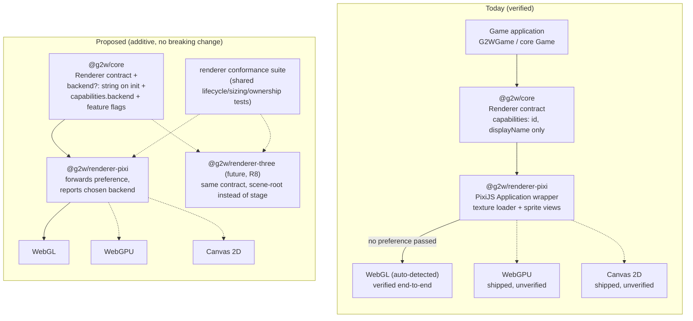

# R6 — Renderer Capability and Architecture Audit

**Repository:** `AlexanderDev2004/g2w` · **Branch audited:** `main` @ `b26248e` (E4) · **Date:** 2026-10-26

This is an audit and design proposal. No Three.js adapter was implemented and no API changed. Every claim below cites the source it was verified against; "unverified" means exactly that.

---

## 1. Current-state audit

### 1.1 The renderer contract (`@g2w/core`)

Source: [packages/core/src/renderer.ts](../packages/core/src/renderer.ts).

The contract every renderer implements:

| Member                                                    | Kind     | Verified semantics                                                                                                                                                    |
| --------------------------------------------------------- | -------- | --------------------------------------------------------------------------------------------------------------------------------------------------------------------- |
| `capabilities: RendererCapabilities`                      | required | Identity only: `{ id, displayName }`. **No capability flags** (no "is 3D", "is WebGL", "supportsX").                                                                  |
| `initialized: boolean`                                    | required | Implementation-reported state.                                                                                                                                        |
| `initialize(options: RendererInitOptions): Promise<void>` | required | Takes `canvas: HTMLCanvasElement`, optional `width`/`height` (logical resolution, both-or-neither, finite > 0), `backgroundColor`, `resolution` (device pixel ratio). |
| `dispose(): Promise<void>`                                | required | Releases renderer-owned resources; must not remove the caller's canvas from the DOM.                                                                                  |
| `render?(): void`                                         | optional | Called once per game-loop frame when present. Renderers that self-drive or cannot render on demand may omit it.                                                       |
| `resize?(width, height): void`                            | optional | Same validation as init sizing; changes logical space + drawing buffer only, never textures.                                                                          |

**Fact (verified):** `RendererInitOptions.canvas` is typed `HTMLCanvasElement` ([renderer.ts:23](../packages/core/src/renderer.ts#L23); mirrored in `game.ts:29`). The core architecture test ([architecture.test.ts:60-66](../packages/core/test/architecture.test.ts#L60)) explicitly allows DOM _types_ while banning runtime browser-global access, so core stays runtime-DOM-free but its renderer contract is type-coupled to the HTML canvas element. This is a deliberate, documented boundary ("DOM types are compile-time only"), and it means a hypothetical off-screen/no-DOM renderer (Node, WebWorker, WebGPU offscreen) would need a contract extension — noted as a gap below, not a defect for the current browser targets.

### 1.2 The only implementation: `PixiRenderer` (`@g2w/renderer-pixi`)

Source: [packages/renderer-pixi/src/pixi-renderer.ts](../packages/renderer-pixi/src/pixi-renderer.ts) (all lifecycle behavior verified in the E3-B regression suite, [pixi-renderer.test.ts:400-660](../packages/renderer-pixi/test/pixi-renderer.test.ts#L400)).
- Wraps one PixiJS v8 `Application`; `initialize()` coalesces concurrent calls, rolls back partial init, aggregates rollback failures; `dispose()` destroys the application synchronously when idle, waits out pending init otherwise, and is terminal until re-init.
- **Backend selection: none.** The adapter passes `canvas`, `autoDensity`, `autoStart: false`, sizing, `backgroundColor`, `resolution` to `Application.init()` ([pixi-renderer.ts, `#initialize`](../packages/renderer-pixi/src/pixi-renderer.ts)). It passes **no `preference` option**, so PixiJS's auto-detection decides the backend.
- Ownership policy (R1): disposal destroys stage display objects only (`removeView: false`, `children: true`, no texture flags); textures live in PixiJS's shared `Assets` cache and are never destroyed by framework disposal — pinned by regression tests including a hazard test asserting the forbidden flags would destroy textures ([pixi-renderer.test.ts:110-243](../packages/renderer-pixi/test/pixi-renderer.test.ts#L110)).
- The adapter also exports the texture loader (`createTextureAssetManager`, non-destructive by design — [assets.ts](../packages/renderer-pixi/src/assets.ts)) and the sprite projection (`createSpriteView`, model→display-object sync with explicit `sync()`, never destroys the shared texture — [sprite-view.ts](../packages/renderer-pixi/src/sprite-view.ts)). These two are **PixiJS-specific surfaces**, not part of the core `Renderer` contract: the core generic `AssetManager<T>` and `Sprite2D`/`Transform2D` model are renderer-agnostic; only the loader and the view factory are adapter-specific.

### 1.3 PixiJS 8.22.0 backend facts (verified from the installed package source)

Verified directly from `node_modules/.pnpm/pixi.js@8.22.0/node_modules/pixi.js/lib/rendering/renderers/` (no web sources used):
1. **PixiJS 8 ships three renderer classes**: `WebGLRenderer` (`gl/WebGLRenderer.js`), `WebGPURenderer` (`gpu/WebGPURenderer.js`), and **`CanvasRenderer` (`canvas/CanvasRenderer.js`)**.
2. **Auto-detection order** (`autoDetectRenderer.js`): `["webgl", "webgpu", "canvas"]` — each is gated by `isWebGLSupported()` / `isWebGPUSupported()`; `canvas` has **no support check** and acts as the final fallback. A non-array `preference` option puts the preferred backend first and keeps the rest as fallbacks; an array `preference` is used exactly as ordered.
3. **The canvas backend is scene-limited.** `CanvasRenderer` composes `SharedSystems` plus four canvas-specific systems and only these pipes: `BlendModePipe`, `BatcherPipe`, `SpritePipe`, `RenderGroupPipe`, `AlphaMaskPipe`, `CanvasStencilMaskPipe`, `CanvasColorMaskPipe`, `CustomRenderPipe`, with only `CanvasBatchAdaptor` and `CanvasGraphicsAdaptor`. Concretely: sprites, graphics, containers, and masks render on canvas 2D; **filter-based effects and any pipe not in that list have no canvas implementation**. (This is source evidence of coverage, not a benchmark of correctness.)
4. Therefore the README's line "PixiJS 8 dropped its canvas renderer" ([README.md:80](../README.md)) is **factually wrong as stated** and is corrected in this audit: PixiJS 8 ships a `CanvasRenderer`; what is true is that _g2w has not verified it end-to-end_ (init with `preference: "canvas"`, rendering, masks, and the adapter's sprite path on it), and that the canvas backend's narrower pipe set is a real compatibility risk for the demo's `Graphics`- and `Text`-based scenes until tested. The correct status is **"exists in PixiJS 8, unverified by g2w"** — better than "dropped", weaker than "supported".

### 1.4 How the runtime and game consume the renderer

- Core `Game` ([packages/core/src/game.ts](../packages/core/src/game.ts)): owns one `Renderer`, drives `render()` once per frame from the rAF loop, owns lifecycle (init races, stop/dispose), passes sizing through.
- `G2WGame` (`@g2w/runtime`, [packages/runtime/src/game.ts](../packages/runtime/src/game.ts)): treats renderer initialization as one lifecycle effect on the managed Effect runtime and registers renderer release as the last LIFO finalizer. Effect ownership is confined to the runtime package; adapters and core are Effect-free (enforced by tests and by the E3 boundary).
- The hello-world demo ([examples/hello-world/src/main.ts:129-149](../examples/hello-world/src/main.ts#L129)) boots through `G2WGame` and composes input/gamepad/audio/assets as caller finalizers. It uses `Graphics`, `Text`, sprites, and one texture — all within the WebGL/canvas common subset except unverified canvas rendering of `Graphics` (which does have a `CanvasGraphicsAdaptor` in PixiJS 8, per 1.3).

### 1.5 Boundaries currently enforced (verified)

- `@g2w/core` declares zero dependencies and no PixiJS/Effect dependency ([architecture.test.ts:33-66](../packages/core/test/architecture.test.ts#L33): no runtime deps, no PixiJS in any dependency group, no concrete-renderer imports, no browser globals at runtime).
- `@g2w/renderer-pixi` depends only on `@g2w/core` (workspace) with `pixi.js >=8` as a peer dependency and `8.22.0` as the dev dependency ([packages/renderer-pixi/package.json](../packages/renderer-pixi/package.json)) — verified by a dependency-direction test ([pixi-renderer.test.ts:47-70](../packages/renderer-pixi/test/pixi-renderer.test.ts#L47)).
- No `ManagedRuntime` exists in any adapter; per-frame code allocates no Effect runtime/effect/promise (E3/E4 boundary, documented in AGENTS.md).

---

## 2. Engine-level vs. 2D-specific concepts

**Genuinely engine-level** (belong in the renderer contract as-is or with small generalization):
- Lifecycle state machine (`initialize`/`dispose`/`initialized`), concurrency and rollback semantics — proven generalizable by E3-B: nothing in them is PixiJS-specific.
- Identity/capability reporting (`RendererCapabilities`) — engine-level, but currently _too thin_ (see gaps).
- Render surface ownership rules (caller owns the canvas/DOM element; renderer owns its internal resources) — engine-level.
- Resize and logical-resolution policy (R3) — engine-level for 2D and equally meaningful for 3D (Three.js has the identical `setSize`/pixel-ratio problem).
- The game-loop `render()` hook — engine-level by construction (the loop is in core).
- Asset/view ownership split (core model + adapter view factory) — engine-level _pattern_: `Sprite2D`'s generic `TTexture` handle and `createSpriteView`'s shape (`{ sprite, renderer }` → view with `sync()`/`dispose()`) generalize to any backend, including Three.js objects.

**2D-sprite-specific** (correctly _not_ in the contract today, and should stay out):
- Stage/`Container` exposure — `PixiRenderer.stage` is an adapter extension, not part of `Renderer`. Good: a Three.js adapter would expose a scene root instead.
- Anchors, z-order, the shared-texture/`Assets`-cache policy — 2D-sprite and PixiJS-cache concepts. The texture _policy_ (never destroy what you cannot prove you own) is engine-level; the _mechanism_ is not.
- Canvas element as the render target — browser-2D-specific (see gap G6).

---

## 3. Current vs. target capability matrix

| Capability                                          | Current (verified)                                                                                                                                                 | Target                                    | Gap       |
| --------------------------------------------------- | ------------------------------------------------------------------------------------------------------------------------------------------------------------------ | ----------------------------------------- | --------- |
| 2D rendering over WebGL                             | **Done** — `PixiRenderer` + PixiJS 8 WebGL; demo verified in headless-browser CDP smoke (13/13 checks, pixel-verified scenes)                                      | 2D for desktop + mobile web               | —         |
| 2D over WebGPU                                      | **Exists in PixiJS 8, unverified by g2w** — `WebGPURenderer` present in the installed package; auto-detection prefers webgl first, so g2w never exercises it       | Optional quality/perf tier                | G4        |
| 2D over Canvas 2D                                   | **Exists in PixiJS 8, unverified by g2w** — `CanvasRenderer` present with a sprite/graphics/mask pipe set; README wrongly says "dropped" (corrected by this audit) | Fallback for WebGL-less environments      | G4        |
| Renderer backend selection                          | **Not exposed** — the adapter passes no `preference`; PixiJS auto-detects (webgl → webgpu → canvas)                                                                | Choose/verify backend per init            | G4        |
| Backend/capability reporting                        | **Missing** — `RendererCapabilities` has only `id`/`displayName`; the actual backend used is not observable through the contract                                   | Queryable capabilities incl. backend id   | G5        |
| 3D rendering                                        | **Absent** — exploratory R8; no package                                                                                                                            | Three.js adapter behind the same contract | G1–G3, G7 |
| Multi-render-surface (offscreen, multiple canvases) | **Absent** — contract types a single `HTMLCanvasElement`                                                                                                           | Optional future                           | G6        |
| Desktop + mobile browsers                           | **Target platform**; desktop verified via smoke runs. Mobile is unverified (no mobile smoke evidence in the repo)                                                  | Both                                      | G8        |

---

## 4. Proposed renderer architecture

No API breaks. Two small additive extensions to `@g2w/core` (G4+G5) and one documentation correction; everything else is adapter-side or future work.

Reading the diagram: today there is exactly one adapter and the backend is an implementation detail g2w neither selects nor reports. The proposal adds two optional fields to the existing contract (an optional `backend` in `RendererInitOptions` and richer `RendererCapabilities`), keeps the E3-B lifecycle semantics and the R1 texture policy untouched, and makes conformance a shared suite so a future Three.js adapter proves the same lifecycle contract rather than being trusted to.

### Why the contract generalizes to 3D without breaking

1. **Lifecycle**: `initialize`/`dispose` + async init + idempotent terminal disposal maps 1:1 onto Three.js (`WebGLRenderer` construction, `renderer.dispose()`, `renderer.forceContextLoss()`); nothing PixiJS-specific is implied.
2. **Sizing/resize**: R3's logical-space + optional `resize()` is backend-neutral (Three.js: `setSize` + `setPixelRatio`).
3. **render() hook**: the loop calls it; a Three.js adapter implements it as `renderer.render(scene, camera)`. Camera/projection is 3D-specific and correctly stays adapter-side.
4. **Model/view split**: `Sprite2D<TTexture>` + view factory generalizes; a 3D adapter can keep the same handle pattern for its object types (meshes), or core grows an explicit 3D model later — an R8 decision, not a contract defect.
5. **What would need extending** (not breaking, additive): capability reporting (below) and, only if R8 actually starts, possibly camera/scene-root concepts — both can be optional members.

---

## 5. Architectural gaps, ranked

### G4 — P1: Backend selection is neither exposed nor verified (highest-value, smallest)

The adapter forwards no `preference`; g2w cannot pin WebGPU/Canvas or force the WebGL fallback, and no test exercises a non-default backend. PixiJS 8 ships all three renderers (verified, §1.3), but the demo has only ever run auto-detected WebGL.
**Proposal:** add optional `backend?: "webgl" | "webgpu" | "canvas"` (or pass-through string) to `RendererInitOptions`, forwarded by `PixiRenderer` to `Application.init({ preference })`; PixiJS's own fallback ordering applies for unavailable backends. Deterministic tests: fake application records the preference. Real-backend verification is a separate manual/CI matrix item (see §7).

### G5 — P1: `RendererCapabilities` cannot report what actually runs

Today: `{ id, displayName }` only. An application (and the DevTools overlay) cannot learn which backend was selected — directly relevant to the "Canvas and WebGL capabilities" goal.
**Proposal:** additive optional fields: `backend?: string` (what the underlying engine chose, e.g. read from the PixiJS renderer after init) plus per-feature flags (`resize`, `render` are already contract-optional, so flags would document them). Additive only; existing implementations unaffected.

### G2 — P2: No renderer-conformance suite

The lifecycle/sizing/ownership semantics are currently pinned only inside `pixi-renderer.test.ts`. A future Three.js (or any second) adapter has no reusable contract tests to inherit — the main structural risk to the "renderer contract generalizes" claim.
**Proposal:** extract a `testRendererConformance(createRenderer, opts)` harness (core-internal or a small shared test util package) asserting: lifecycle races, rollback, terminal disposal, sizing rules, never-destroys-foreign-resources policy, canvas-stays-in-DOM. Wire the PixiJS suite onto it as the first consumer.

### G1 — P3: 2D-isms in core model naming (documentation-level, no code change)

`Transform2D`, `Sprite2D`, anchors, z-order are 2D concepts in the _core_ package. This is correct for the current scope (AGENTS.md: 3D is exploratory) and requires no action until R8; at that point the decision is whether 3D reuses the model (extension) or gets parallel types (additive). Record in R8's gate, not as a refactor now.

### G3 — P3: Adapter-extra surface is implicit

`createTextureAssetManager`/`createSpriteView` live in the renderer package but are not part of `Renderer`. This is by design (ownership split, §2), but nothing documents _which_ adapter exports are contract vs. convenience. A short "adapter surface" note in docs/architecture.md (see §7) closes the documentation gap without API change.

### G6 — P4: Single `HTMLCanvasElement` target

Contract-level type coupling to the browser canvas. Fine for both stated targets (desktop + mobile browsers); becomes relevant only for offscreen/multi-surface rendering. Defer; record as future extension (`renderTarget` abstraction) if ever needed.

### G7 — P4: No capability negotiation between loop and renderer

The game loop assumes `render()` when present; it cannot ask "is on-demand rendering supported?". The optional-hook pattern already handles it implicitly; a capabilities flag (G5) makes it explicit if a self-driving renderer ever arrives.

### G8 — P4: Mobile verification

The demo has smoke evidence on desktop Chrome only. Mobile browsers are a stated target; viewport/dpr/input behavior on mobile is untested. Proposal: a mobile-emulation smoke pass (CDP device emulation) in a follow-up verification task — no code change expected.

---

## 6. Canvas and WebGL support: explicit statement

- **WebGL 2D rendering: CONFIRMED.** Implemented and tested (`PixiRenderer` suite, 30+ tests incl. lifecycle E3-B hardening) and verified end-to-end in a real headless-Chrome CDP smoke run on the E4 demo (canvas with WebGL backing buffer 640×360×dpr, pixel-verified scene transitions, 13/13 checks, no errors). The WebGL _path_ is exercised on the auto-detected backend.
- **Canvas 2D rendering: UNVERIFIED (exists upstream).** PixiJS 8.22.0 ships `CanvasRenderer` (verified in the installed package source) with sprite/graphics/mask pipes, but g2w has never initialized or rendered with `preference: "canvas"`; no test, no smoke. The README's "dropped" claim is wrong and must be corrected. **Partial at best** — treat as a verification task (G4 + a real-backend smoke), not an implemented capability.
- **WebGPU rendering: UNVERIFIED.** `WebGPURenderer` ships in PixiJS 8.22.0 and auto-detection covers it after WebGL, but g2w has never exercised it (no preference control, no test, no smoke evidence). Same treatment as Canvas.
- **3D: NOT IMPLEMENTED.** Exploratory R8; no code, no claims.
- **Mobile browsers: TARGET, UNVERIFIED.** Desktop-verified only.

The E4 browser smoke test proves the _demo runs_ on the auto-detected (WebGL) backend in one desktop environment. It does not prove backend compatibility across WebGL/WebGPU/Canvas, across GPU drivers, or across mobile browsers — those require the selection API (G4) plus a verification matrix, which is why they are proposed as the next milestone rather than claimed here.

---

## 7. Documentation corrections (the only changes this audit makes)

1. **README.md layer table, line ~80**: "Unverified — PixiJS 8 dropped its canvas renderer" → correct to "PixiJS 8 ships a canvas renderer; g2w has not verified it end-to-end (init, sprites, graphics, masks) — a verification task, not a capability." The current text is contradicted by the installed PixiJS 8.22.0 source (`canvas/CanvasRenderer.js` exists).
2. **docs/architecture.md, `@g2w/renderer-pixi` section**: add one sentence naming the adapter's non-contract exports (`createTextureAssetManager`, `createSpriteView`) as adapter-specific conveniences outside the `Renderer` contract (G3).
3. No other doc/source changes. `@g2w/core`, the adapter code, and all tests are untouched by this audit.

## 8. Validation performed

- This is a documentation-only change: the diff touches `README.md` and `docs/architecture.md` only.
- Run: `pnpm check` (0), `pnpm typecheck` (0). Source and tests were not modified, so `pnpm build` / `pnpm test` / `pnpm verify:exports` results are unchanged from the E4 CI run (Validate ✅ on `b26248e`) — they were not re-run for this audit and no pass is claimed from them here beyond that CI run.

## 9. Recommended next milestone

**R6-1 — Renderer backend selection and capability reporting (G4 + G5 + doc correction shipped with it).**
Scope: additive `backend` init option (forwarded as PixiJS `preference`), `RendererCapabilities.backend` reporting, deterministic tests via the injectable `createApplication`, README/docs truth-up. Small, additive, no boundary changes, directly unblocks the Canvas/WebGPU verification work and makes the "which backend am I on" question answerable — the foundation every later renderer decision (R8 included) sits on.

**Then R6-2 — Conformance suite (G2)** before any second adapter: extract the shared contract test harness with PixiJS as its first consumer. R8 (Three.js) starts only after R6-1/R6-2, per the existing R8 gate.
